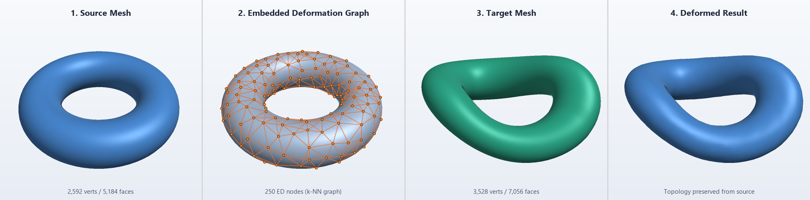
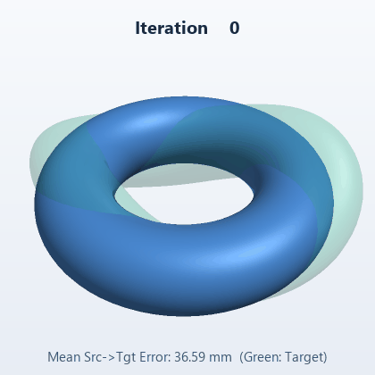
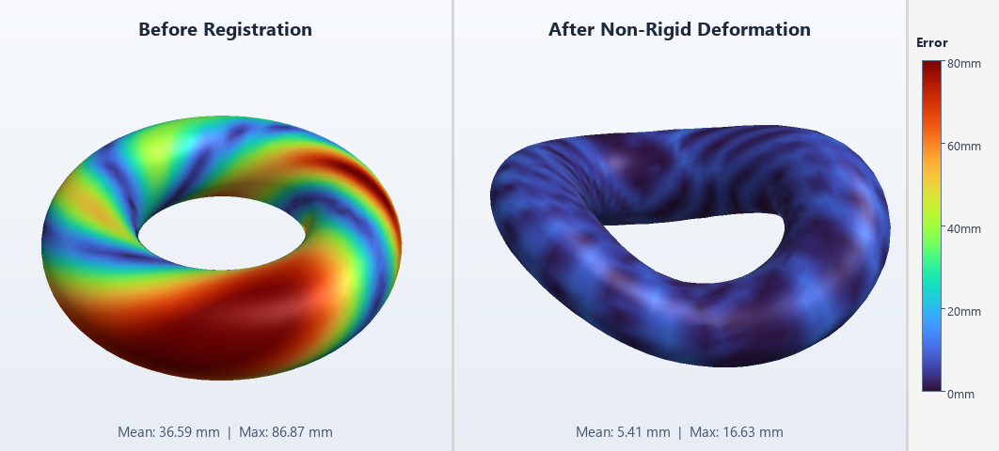
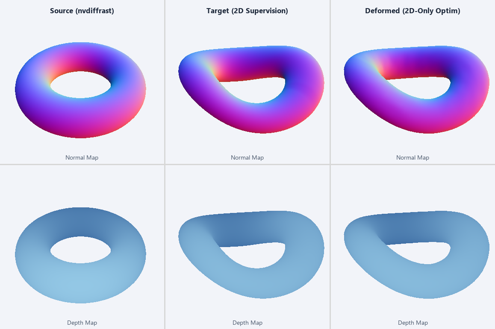

# non-rigid-pytorch

A lightweight, PyTorch-based implementation of **Embedded Deformation (ED-Graph)** non-rigid surface registration, designed to be easy to read, customize, and integrate into 3D/4D reconstruction projects.



## Environment Setup

We recommend using Conda to manage the virtual environment:

```bash
conda create -n nrd python=3.10  # Python 3.9 - 3.12 supported
conda activate nrd

# Install PyTorch matching your CUDA version (see https://pytorch.org/get-started/locally/)
pip install -r requirements.txt
```

### Optional Extensions
* **PyTorch3D** (`knn_points` CUDA kernel): used automatically when installed; otherwise `util/mesh_util.py` falls back to a chunked pure-PyTorch GPU/CPU implementation with no extra setup required.
  ```bash
  pip install "git+https://github.com/facebookresearch/pytorch3d.git@stable"
  ```
* **nvdiffrast** (required only if you use `./renderer/ulit_renderer.py` for differentiable rendering):
  ```bash
  pip install "git+https://github.com/NVlabs/nvdiffrast.git"
  ```

## Quick Start (Demo)

A ready-to-run synthetic mesh pair (`assets/data/source.obj` and `assets/data/target.obj`, in meters, with **different vertex counts and triangulations**) is included in the repository.

Run the non-rigid deformation demo directly:

```bash
python nrd.py
```

This builds a 250-node Embedded Deformation Graph on the source mesh, optimizes per-node local affine transforms $(R_j, t_j)$ with PyTorch `AdamW`, and saves:
* `./debug_out/nrd_demo/ed_graph.obj` — the Embedded Deformation Graph (nodes & edges)
* `./debug_out/nrd_demo/{iter}.obj` — intermediate deformed meshes every `log_iter` steps
* `./debug_out/nrd_demo/deformed_final.obj` — the final deformed mesh

### Custom Meshes & CLI Options

```bash
python nrd.py \
  --src ./assets/data/source.obj \
  --target ./assets/data/target.obj \
  --out_dir ./debug_out/nrd_demo \
  --max_iter 1500 \
  --log_iter 100 \
  --lr 8e-4 \
  --node_num 250 \
  --ed_k 6 \
  --v_k 4 \
  --dist_thres 0.15
```

> **Note:** Mesh vertex coordinates are assumed to be in **meters**. Adjust `--dist_thres` and the regularization weights in `nrd.py` if your meshes use a different scale.

To regenerate the sample meshes or re-render the visualizations below:

```bash
python scripts/generate_demo_data.py
python scripts/render_demo_visuals.py
```

## Demo Results

### Optimization Progress
Deforming the source mesh (blue, 2,592 verts / 5,184 faces) onto the target mesh (translucent green, 3,528 verts / 7,056 faces) over 1,500 iterations:

<p align="center">
  
</p>

### Registration Accuracy (Before vs. After)



| Stage | Src → Tgt Mean | Src → Tgt Max | Symmetric Chamfer |
| :--- | :---: | :---: | :---: |
| Before registration | 36.59 mm | 86.87 mm | 37.08 mm |
| After non-rigid deformation (1,500 iters) | **5.41 mm** | **16.63 mm** | **6.25 mm** |

*(Metrics measure nearest-vertex distance between meshes of differing resolutions; vertex spacing on the target mesh is ~15–28 mm.)*

### Multi-View Differentiable Rendering Demo (`nvdiffrast`)

To demonstrate extending the ED-Graph optimizer with 2D differentiable rendering supervision via `./renderer/ulit_renderer.py`, run:

```bash
python demo_nvdiffrast.py
```

This script optimizes `DeformableMesh` using **only 2D multi-view renders** (8 orbiting OpenCV cameras supervising antialiased silhouette, depth, and normal maps — without any 3D point-to-point correspondence), reducing 3D Chamfer distance from **37.08 mm → 11.44 mm** in 600 iterations:



## Configurable Energy Terms

`NonRigidDeformer` in `./core/deform.py` exposes modular loss terms that can be toggled or extended via `deformer_args`:

| Flag | Description |
| :--- | :--- |
| `point2point` | Nearest-neighbor point-to-point Euclidean distance to `target_mesh` |
| `point2plane` | Normal-weighted surface alignment error to `target_mesh` |
| `E_rot` | Orthonormality regularization encouraging local node matrices $R_j \in SO(3)$ |
| `E_reg` | Embedded Deformation smoothness across neighboring ED nodes (Sumner et al. 2007) |
| `E_nc` | Vertex and face normal consistency relative to the rest pose |
| `E_edgelen` | Edge-length preservation to prevent triangle distortion/collapse |
| `E_fixable` | Anchors vertices outside `[dist_thres_lower, dist_thres]` to their original positions |
| `E_corr` | Sparse 3D correspondence constraint (via `DeformableMesh.set_correspondence`) |

## Core Files

* `./nrd.py` — End-to-end runnable 3D registration demo script with CLI arguments, ED-Graph export, and registration metrics.
* `./demo_nvdiffrast.py` — Multi-view differentiable rendering non-rigid deformation demo using `NvdiffrastMeshUlitRenderer` (2D silhouette/depth/normal supervision only).
* `./core/deform.py` — `NonRigidDeformer` optimization loop with modular, easily extensible loss terms.
* `./util/mesh.py` — `Mesh` and `DeformableMesh` classes, FPS ED-node sampling, Euclidean & geodesic skinning, and deformation forward pass.
* `./util/mesh_util.py` — Geometry utilities (normals, edges, connected faces, Laplacian, FPS sampling, and PyTorch3D / pure-PyTorch `knn_points`).
* `./util/obj_io.py` — Custom OBJ/PLY I/O with helpers (`save_ednode`, `save_ednode_and_verts`) for debugging and visualizing ED-Graphs.
* `./renderer/ulit_renderer.py` — Differentiable unlit renderer using `nvdiffrast` with OpenCV camera conventions aligned to PyRender.
* `./scripts/generate_demo_data.py` — Procedural generator for the synthetic demo mesh pair in `./assets/data/`.
* `./scripts/render_demo_visuals.py` — Visualization script that produces the overview figure, error heatmap, and progress GIF in `./assets/`.

## Citation

If you find this project useful, please consider citing:

```bibtex
@incollection{sumner2007embedded,
  title={Embedded deformation for shape manipulation},
  author={Sumner, Robert W and Schmid, Johannes and Pauly, Mark},
  booktitle={ACM SIGGRAPH 2007 papers},
  pages={80--es},
  year={2007}
}
```

This project can also serve as a prototype for [Project EvolvingGS](https://evolvinggs.github.io), [Project DisentangledGS](https://distangledgs.github.io/), and [Project Live4D](https://live4d-vv.github.io) (Non-Rigid Deformation, PyTorch version).

```bibtex
@incollection{zhang2025evolvinggs,
  title={EvolvingGS: Stable Volumetric Video via High-Fidelity Evolving 3D Guassian Reconstruction},
  author={Zhang, Chao and Zhou, Yifeng and Wang, Shuheng and Li, Wenfa and Wang, Degang and Xu, Yi and Jiao, Shaohui},
  booktitle={Proceedings of the SIGGRAPH Asia 2025 Technical Communications},
  pages={1--4},
  year={2025}
}

@incollection{zhou2025disentangled,
  title={Disentangled Gaussian Splatting: High-Fidelity Relightable Volumetric Video through Geometry-Appearance Decoupling},
  author={Zhou, Yifeng and Zhang, Chao and Wang, Shuheng and Li, Wenfa and Yi, Xu and Wang, Degang and Chen, Yuzhong and Jiao, Shaohui},
  booktitle={Proceedings of the SIGGRAPH Asia 2025 Technical Communications},
  pages={1--4},
  year={2025}
}

@incollection{zhou2023live4d,
  title={Live4D: a real-time capture system for streamable volumetric video},
  author={Zhou, Yifeng and Wang, Shuheng and Li, Wenfa and Zhang, Chao and Rao, Li and Cheng, Pu and Xu, Yi and Ke, Jinle and Feng, Wenduo and Zhou, Wen and others},
  booktitle={SIGGRAPH Asia 2023 technical communications},
  pages={1--4},
  year={2023}
}
```
